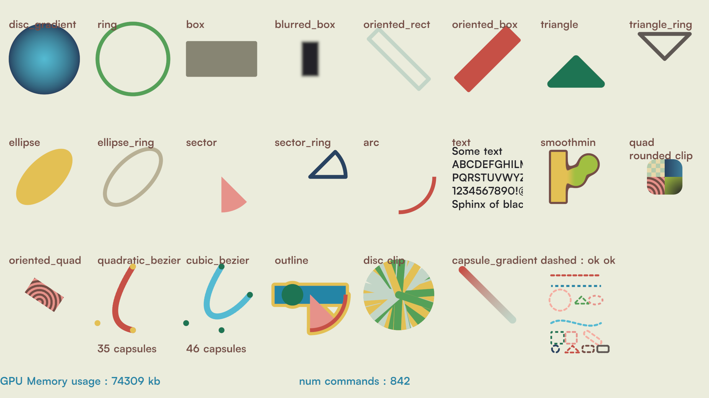

# onedraw
**GPU-driven sdf 2D renderer drop-in library**

`onedraw` is designed to render everything in a single draw call, maximizing GPU efficiency for 2D graphics. More details can be found in the [documentation](doc/index.md). It relies on Apple Metal API, wave instructions, and indirect draw calls, so adapting it to other graphics APIs would require significant changes (but feel free to contact me if you want to do a port).

### Screenshot



### Features
* **Single draw call rendering** – as the name suggests, all primitives are drawn in one draw call.
* **Hierarchical tile-based binning** – the compute shader processes only the primitives that influence each tile, reducing wasted work.
* **Tile cache** – opt-in via the `cache` flag of `onedraw_def`: unchanged tiles are redrawn from a full-screen cache texture instead of being re-shaded (4 extra bytes per pixel). On the mostly-static 1440p test scene (M5 Pro, 20 GPU cores) the GPU frame time drops from 1.69 ms to 1.11 ms (−34 %).
* **Shader-based alpha blending** – all blending operations are handled in the shader, no framebuffer read/write required.
* **Anti-aliasing** – smooth edges using signed distance functions.
* **Lightweight and minimal** – drop-in library with minimal dependencies.
* **Baked font** – ready-to-use text rendering; the pre-build step can bake a custom font instead ([Custom font](#custom-font)).
* **Wide shape support** – box, blurred box, rectangle, oriented box/rectangle, triangle, triangle ring, disc, circle, ellipse, ellipse ring, arc, sector, sector ring, Bézier curves (quadratic & cubic), textured quad, oriented textured quad.
* **Dashed shapes** – dashed variants of line, ring, box, oriented box, ellipse ring and triangle ring, with configurable dash length, gap, phase and round/flat caps.
* **Gradient fills** – radial gradient disc and two-color capsule.
* **Shape operations** – shapes can be grouped (boolean add), [smooth minimum](https://iquilezles.org/articles/smin/) is supported for more organic shapes, outline can be drawn around entire group, and clip shapes (rect, rounded rect, disc) can be pushed/popped (up to 256 per frame).
* **C99 API** – although the renderer is implemented in C++ using MetalCPP, the public interface is fully C99, so it can be used in C projects. All examples are written in C.


### Integration
1. Copy all files from the `/lib` folder.
2. Add `onedraw.cpp` to your build system.
3. Create your window and provide the Metal device and drawable object.
4. Link with Metal framework


### Minimal example
```c
#include <stdlib.h>
#include <stdio.h>

#define SOKOL_METAL
#include "sokol_app.h"

#include "../lib/onedraw.h"

struct onedraw* renderer;

void init(void)
{
    renderer = od_init( &(onedraw_def)
    {
        .metal_device = (void*)sapp_metal_get_device(),
        .preallocated_buffer = malloc(od_min_memory_size()),
        .viewport_width = (uint32_t) sapp_width(),
        .viewport_height = (uint32_t) sapp_height()
    });
}

void frame(void)
{
    od_begin_frame(renderer);
    od_draw_text(renderer, 0, 0, "Hello world!", 0xffffffff);
    od_end_frame(renderer, (void*)sapp_metal_get_current_drawable());
}

void cleanup(void)
{
    od_terminate(renderer);
    free(renderer);
}

sapp_desc sokol_main(int argc, char* argv[])
{
    return (sapp_desc) 
    {
        .width = 1280,
        .height = 720,
        .init_cb = init,
        .frame_cb = frame,
        .cleanup_cb = cleanup
    };
}

```

See [tests/test.c](tests/test.c) for an example testing all features using [sokol_app.h](https://github.com/floooh/sokol/blob/master/sokol_app.h) for the window management.

### Build

Follow the step to build and run the test program

* mkdir build
* cd build
* cmake ..
* make
* ./test

#### Custom font

The pre-build step bakes `fonts/Satoshi-Bold.otf` into `lib/` as a BC4 atlas. To experiment with another font (e.g. `fonts/JetBrainsMono-Regular.ttf`), run the builder manually from the project root, then rebuild:

```
./build/pre-build/builder fonts/JetBrainsMono-Regular.ttf
cmake --build build
./build/test --autoexit
```

This overwrites the generated headers in `lib/`, so the regression gate (`--compare`) fails until the default font is baked again (`./build/pre-build/builder`) and the project is rebuilt.


### Links and references

[Metal API](https://developer.apple.com/metal/cpp/)

[Inigo Quilez's articles](https://iquilezles.org/articles/)

[Sokol libraries](https://github.com/floooh/sokol)

[Satoshi font](https://www.fontshare.com/?q=Satoshi)
