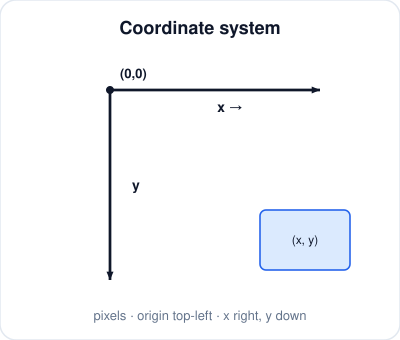

# Frequently Asked Questions

### Why Metal only?
At the moment, I only have access to a MacBook Pro, and among modern graphics APIs, **Metal** offers a great balance between simplicity and performance.  
It’s straightforward to work with, yet still powerful enough for advanced GPU-driven techniques.

### Why isn’t it a single-header library?
That’s a deliberate design choice.  
While it would be possible to embed all shaders and headers directly into `onedraw.cpp`, it would make the file harder to read and maintain.  
Instead, the library remains a **single C++ source file** to add to your build system, while keeping shaders and headers separate for clarity.

### What are the by-design limits of the renderer?
We support up to :
* 65536 draw commands (including begin/end group)
* 256 clip shapes (rect, rounded rect, disc)
* max viewport resolution of 4096x4096
* 256 slices texture array

### What is the coordinate system used?

Coordinates are expressed in pixels, with the x-axis increasing to the right and the y-axis increasing downward.

The origin `(0, 0)` is the **top-left** corner of the back buffer. There is no internal transform — a shape drawn at `(10, 10)` appears 10 pixels from the left and 10 pixels from the top.

### Does the library cull objects?

Objects outside the screen are not rasterized, but draw commands are still issued. We recommend implementing a high-level culling system if many objects fall outside the screen to avoid wasting draw calls and GPU resources.

As for primitives that are on the screen but completely covered, there is a limited built-in mechanism: during tile binning, a fully opaque, solid, unclipped axis-aligned box that strictly contains a tile stops the tile's command walk, so whatever was drawn under that box is skipped ([occlusion culling](part2.md)). Redundant primitives hidden under anything else — a semi-transparent, clipped, or grouped box, or a non-rectangular shape — are still evaluated.

### Does the library work on iOS?

It should but it has not been tested, so one should not expect a smooth experience on iOS. Especially BC4 texture might not be supported, one should convert the font texture in R8 format.
