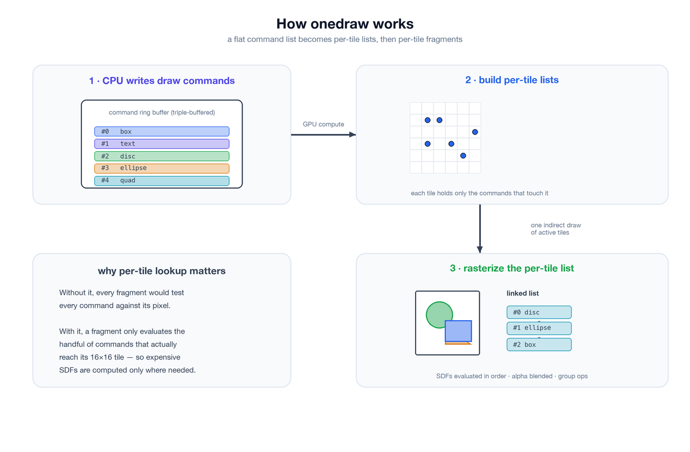
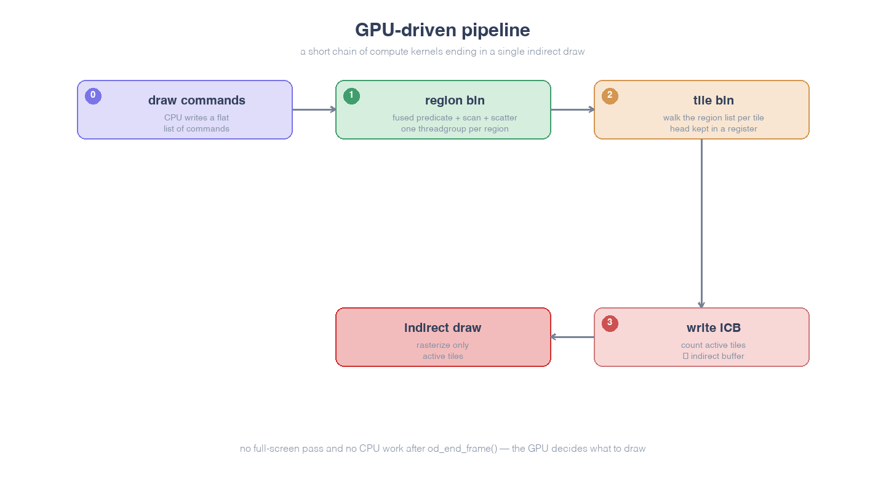

# onedraw — a GPU-driven 2D renderer

| Section | Description |
|---------|-------------|
| [Overview](index.md) | Goals and initial architecture |
| [Part 1](part1.md) | Binning commands |
| [Part 2](part2.md) | Hierarchical binning and intrinsic tricks |
| [Part 3](part3.md) | Rasterization |
| [Part 4](part4.md) | Font and textured quads |
| [Part 5](part5.md) | Stats and next steps |
| [API](../lib/onedraw.h) | The header documents the full API |
| [FAQ](FAQ.md) | Frequently asked questions |

---

## Goals and initial architecture

The project set out with four objectives that shape every design decision:

* **Not triangle-based.** Shapes are described by [signed distance functions (SDFs)](https://iquilezles.org/articles/distfunctions2d/), not triangulated meshes.
* **High quality.** Anti-aliased edges by default and perfectly smooth curves, optimized for high-resolution displays.
* **Fast and GPU-driven.** As much work as possible is offloaded to the GPU, and draw calls are minimized.
* **Efficient alpha blending.** Designed for heavy transparency use without a significant performance cost.

---

## Overview

Because shapes are rendered with [SDFs](https://iquilezles.org/articles/distfunctions2d/) — which can be comparatively expensive to evaluate — efficient culling is essential to keep fragment work low.

`onedraw` achieves that by dividing the screen into **16×16 pixel tiles** and, in a **compute shader**, building a **linked list of draw commands per tile**. When a tile is rasterized, the fragment shader reads exactly that tile's list, so it only evaluates the handful of shapes that actually reach it instead of testing every command against every pixel. That small per-tile lookup is a large win at fragment time.

---

## GPU-Driven Pipeline

The whole binning phase runs **on the GPU** as a short chain of compute kernels that ends in a single **indirect draw call**:

| Stage | What it does |
|-------|--------------|
| **draw commands** | The CPU writes a flat list of commands (type, color, quantized AABB, `data[]`) into a double-buffered ring. |
| **region bin** | One threadgroup per region walks the command list, testing each command's AABB against the region and scattering the visible, order-preserving indices into the region's list — a fused predicate + scan + scatter in a single kernel. |
| **tile bin** | For every tile, walks its region's list and appends the matching commands to the per-tile linked list, keeping each tile's head in a register; the walk stops at the first fully opaque box that covers the tile ([occlusion culling](part2.md)). |
| **write indirect args** | Counts the tiles to shade and the tiles to copy, and writes the two indirect draw buffers. |

Because every tile with at least one command is appended to a list of tiles to render, the **indirect draw** rasterizes *only* the tiles that need it — no full-screen pass, and no CPU work after `od_end_frame()`. With the [tile cache](part1.md) on, only the tiles that changed this frame are shaded; unchanged tiles are appended to a second list and redrawn from the cache by a second indirect draw.

### Key constants

| Constant | Value | Meaning |
|----------|-------|---------|
| `TILE_SIZE` | `16` | pixels per tile edge |
| `REGION_SIZE` | `16` | tiles per region edge (a region is 16×16 tiles) |
| `MAX_COMMANDS` | `65,536` | draw commands per frame (including begin/end group) |
| `MAX_CLIPS` | `256` | clip shapes per frame |
| `SIMD_GROUP_SIZE` | `32` | Apple Silicon wavefront size |
| `MAX_NODES_COUNT` | `4,194,304` | headroom for per-tile linked-list nodes |
| `MAX_SCREEN_SIZE` | `4096` | max viewport (the quantized AABB stores tile indices on 8 bits) |

---

[Next part](part1.md) : Binning commands
