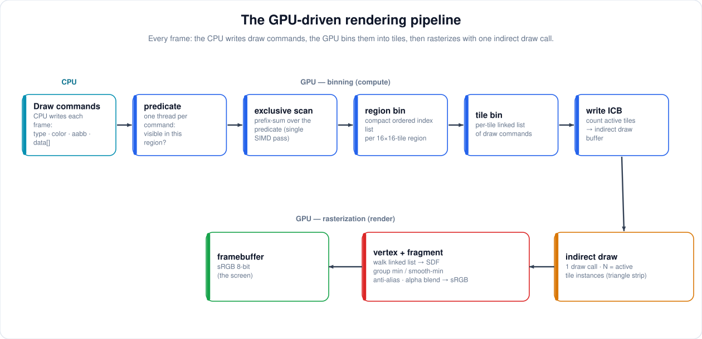

# onedraw — a GPU-driven 2D renderer

| Section | Description |
|---------|-------------|
| [Overview](index.md) | Goals and initial architecture |
| [Part 1](part1.md) | Binning commands |
| [Part 2](part2.md) | Hierarchical binning and intrinsic tricks |
| [Part 3](part3.md) | Rasterization |
| [Part 4](part4.md) | Font and textured quads |
| [Part 5](part5.md) | Stats and next steps |
| [API](../lib/onedraw.h) | Header contains doc about the API |
| [FAQ](FAQ.md) | Frequently asked questions |

---

## Goals and initial architecture

I started the project with the following objectives:

* Not triangle-based: shapes are defined using signed distance functions (SDFs).
* High quality: anti-aliased edges by default, perfectly smooth curves (no tessellation required), optimized for high-resolution displays.
* Fast and GPU-driven: offload as much work as possible to the GPU and minimize draw calls.
* Efficient alpha blending: designed to make extensive use of transparency without significant performance cost.

---

## Overview

To achieve high performance, `onedraw` minimizes unnecessary computations during rasterization. Since it primarily uses [signed distance functions (SDFs)](https://iquilezles.org/articles/distfunctions2d/) to render shapes—and these functions can be relatively expensive—efficient culling is essential.

The screen is divided into **16×16 pixel tiles**. A **compute shader** builds a **linked list of draw commands per tile**. When a tile is rasterized, the fragment shader has direct access to the exact set of draw commands that affect that tile—ensuring that only relevant shapes are processed.

That small per-tile lookup buys a large win at fragment time: instead of testing every command against every pixel, the fragment shader only evaluates the handful of commands that actually reach a given tile.

---

## GPU-Driven Pipeline

The entire binning process happens **on the GPU**. It is a short chain of compute kernels, ending in a single **indirect draw call**:

| Stage | What it does |
|-------|--------------|
| **Draw commands** | The CPU writes a flat list of commands (type, color, quantized AABB, `data[]`) into a triple-buffered ring. |
| **predicate** | One thread per command records, for every region, whether the command is visible (`0` / `1`). |
| **exclusive scan** | A prefix-sum over the predicate computes a compact position for each visible command. |
| **region bin** | Writes the visible, ordered command indices into each region’s list. |
| **tile bin** | For every tile, walks its region’s list and appends matching commands to a per-tile linked list. |
| **write ICB** | Counts the active tiles and writes the indirect draw buffer (`num_tiles`, triangle strip, 4 vertices). |

Because every tile with at least one command is appended to a list of tiles to render, the **indirect draw call** rasterizes *only* the active tiles—no full-screen pass and no CPU involvement after `od_end_frame()`.

### Key constants

| Constant | Value | Meaning |
|----------|-------|---------|
| `TILE_SIZE` | `16` | pixels per tile edge |
| `REGION_SIZE` | `16` | tiles per region edge (a region is 16×16 tiles) |
| `MAX_COMMANDS` | `65,536` | draw commands per frame (including begin/end group) |
| `MAX_CLIPS` | `256` | clip shapes per frame |
| `SIMD_GROUP_SIZE` | `32` | Apple Silicon wavefront size |
| `MAX_NODES_COUNT` | `4,194,304` | headroom for per-tile linked-list nodes |
| `MAX_SCREEN_SIZE` | `4096` | max viewport (the quantized AABB stores tile indices on 8 bits) |

---

[Next part](part1.md) : Binning commands
