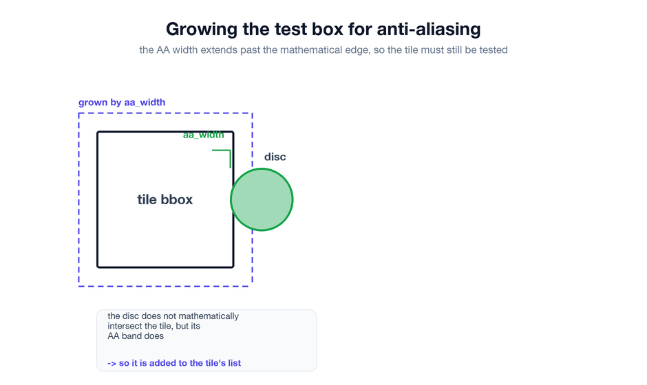
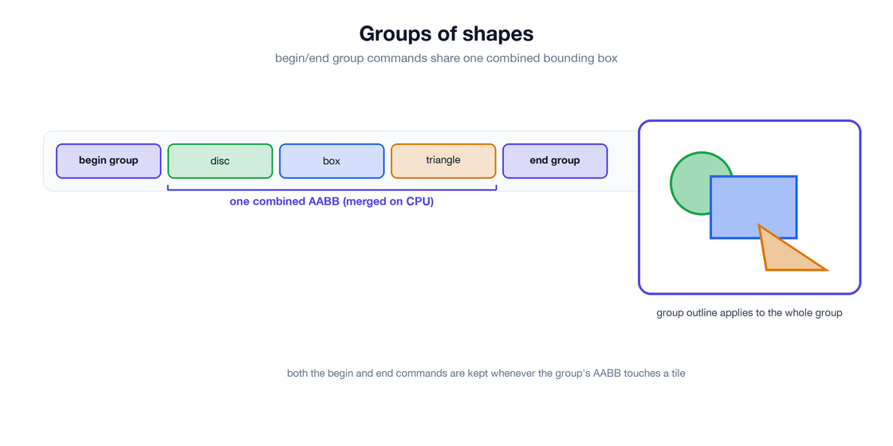
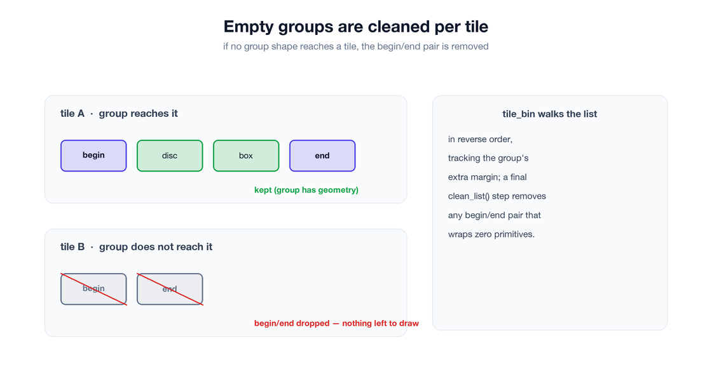
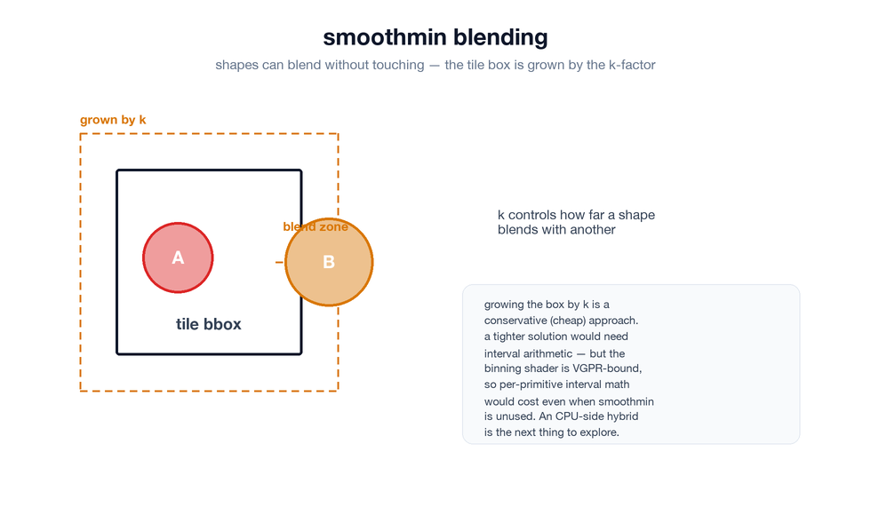

# onedraw — a GPU-driven 2D renderer

## Binning commands

Binning is the step that generates the **per-tile linked lists** of draw commands. It works by testing each draw command against the bounding box of every tile, using a classic intersection method per shape type:

* **oriented boxes / lines / capsules** → Separating Axis Theorem (SAT)
* **discs** → distance-to-nearest-point (plus a "ring" test for hollow ones)
* **pies / arcs** → disc test + a ray / angular slab test
* **triangles** → SAT on the three edges, plus an all-vertices-inside shortcut
* **ellipses** → the tile is mapped into the ellipse's local space, then treated as a circle

Three extra factors are folded into the same test, and each of them makes the effective bounds of a command *bigger* than its mathematical bounds:

* [anti-aliasing](#anti-aliasing)
* [groups of shapes](#group-of-shapes)
* [smoothmin](#smoothmin)

The section below explains how each one is handled so that nothing that touches a tile is missed.

---

## Anti-aliasing

The width of the anti-aliasing region (set by the user) must be accounted for during the intersection test.

In the example above, the disc does not mathematically intersect the tile's bounding box — but its anti-aliasing band does. If we skipped it, we would get visible seams or hard edges along the tile border. So the tile's bounding box is simply **grown by the anti-aliasing width** before the test, and the disc is kept in the tile's list so its edge pixels are shaded correctly.

---

## Group of shapes

`onedraw` lets you combine several shapes into a **group** that behaves like a single shape: it can have a global transparency even though it contains multiple layers, or an outline that applies to the whole group.

A group is defined by wrapping shapes between **begin group** and **end group** commands; the end group command is where the color output (and, if enabled, the outline) is produced.

Each begin/end group command carries a **global bounding box** that encompasses every shape in the group, so both commands are included whenever the group's box touches a tile. If a group has no shapes reaching a given tile, its begin/end pair is removed from that tile's list to avoid pointless work:

On the CPU side, `od_begin_group()` reserves one slot in the quantized-AABB buffer, every shape drawn while the group is open is merged into it, and `od_end_group()` copies the accumulated box onto the end command. On the GPU, the `tile_bin` kernel walks the (reverse-order) list while tracking the current group's extra margin, and a final `clean_list()` step drops any `begin`/`end` pair that wraps zero primitives for that tile.

---

## Smoothmin

The **smoothmin** operator lets several shapes blend smoothly even when they do not intersect. The *k-factor* (from [Inigo Quilez's website](https://iquilezles.org/articles/smin/)) controls how far a shape can blend with another.

During binning, the tile's bounding box is **grown by this k value** so that a shape that contributes to a smooth blend is never missed.

> **Note** — this is a deliberately conservative way to handle smoothmin. A tighter solution would use [interval arithmetic](https://www.mattkeeter.com/research/mpr/), but a few considerations weigh against it:
>
> * we do not support complex trees of boolean operations — only `smoothmin` would benefit from interval arithmetic (`min` is already optimal);
> * the binning shader is already VGPR-bound, so adding interval evaluation for every primitive kind would cost performance even in frames that never use smoothmin;
> * a promising direction is a **hybrid**: evaluate intervals on the CPU and let them adjust the AABB that is tested on the GPU.

---

[Next part](part2.md) : Hierarchical binning and intrinsic tricks
