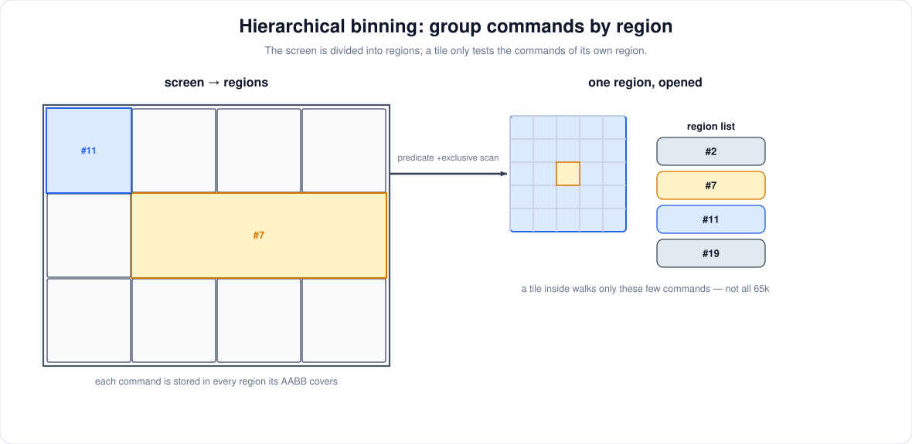
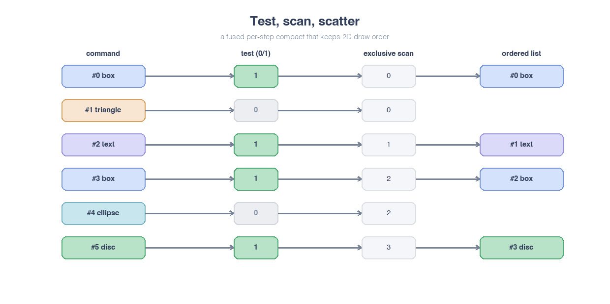
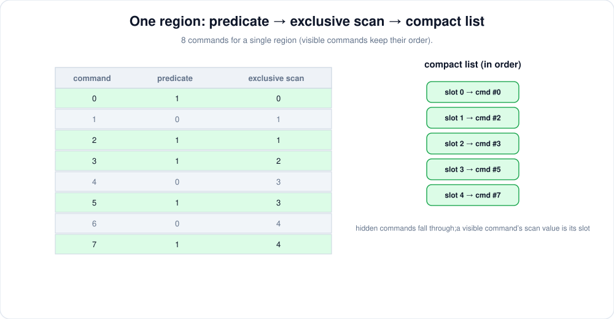
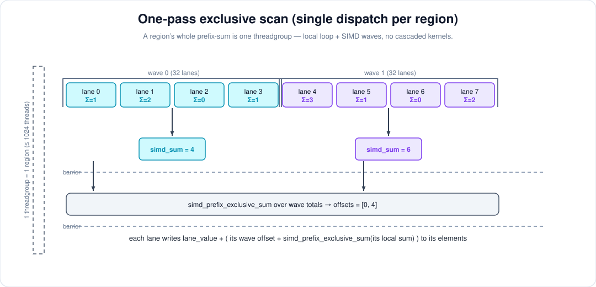

# onedraw — a GPU-driven 2D renderer

## Performance considerations

Even though binning is performed on the GPU, it’s not free. Let’s look at the numbers:

* At 1440p, the screen contains **160 × 90 = 14,400 tiles**
* `onedraw` supports up to **65,536 draw commands**
* In the worst case, that’s around **943 million** intersection tests

With such a naïve approach, the binning step could easily cost more than the actual rasterization. 😬

---

## Quantized AABB

The first optimization is to store an **AABB** (axis-aligned bounding box) for each command and use it as a quick pre-test before running more complex intersection math.  
The bounding boxes are **quantized** to the tile resolution (16 pixels), making the test extremely fast and simple: each edge is a single byte holding a *tile* index (so `0…255`, which caps the viewport at 256 × 16 = 4096 px).

Additionally, the AABBs are stored in a separate buffer from the draw commands to avoid **cache thrashing** and improve memory access efficiency.

---

## Hierarchical binning

Even with AABB pre-tests, having many commands means each tile still performs a significant amount of work.  
To reduce this, we introduce **hierarchical binning** — pre-building a list of commands for larger screen regions.

A region covers **16 × 16 tiles**, and each region keeps a list of the commands that affect it.  
When binning individual tiles, we only consider the commands from that region’s list instead of all global commands.

This sounds great, but there’s a catch:
When binning commands for the region in a compute shader, if we assign one thread per region, it becomes very slow — there are relatively few regions but potentially many commands. GPUs perform best when running **a large number of lightweight threads**, not a few heavy ones.

To fix this, we **invert the process**: each thread processes a single command and adds it to the region lists it intersects.  
However, since this happens in parallel, we lose the guaranteed **ordering of commands**, which is critical in 2D rendering.

## Predicate + exclusive scan

To keep the order of commands, we use the classic pattern :

* A **predicate compute shader** evaluates the visibility of each command (one thread per command) and writes the result — `0` or `1` — to a buffer.  
* An **exclusive scan compute shader** then processes this buffer to build a compact list of visible command indices.  
* Finally, another compute shader uses this predicate and the indices lists to write the corresponding commands into the output buffer.  
  This approach allows us to keep a **thread-per-command** model while efficiently filtering out invisible ones.

This process is applied for all regions.

Here is that exact sequence with real values for one region — note how a visible command’s scan value is precisely its slot in the compact list, while hidden commands fall through:

## One-pass exclusive scan

Building a compact, ordered list from a per-command visibility mask is a classic **exclusive scan** problem. The textbook solution is a *cascaded* scan — a block-level prefix sum, then a scan over the per-block totals, then adding the offsets back — which means three or four separate kernel launches.

`onedraw` does the whole thing in **one dispatch** thanks to two facts:

1. **The scan is per region.** The kernel is dispatched as a `(threads_per_region, num_regions)` grid with a `(threads_per_region, 1)` threadgroup, so *each threadgroup is one region’s line of threads*. With up to 65,536 commands and `num_elements_per_thread = ⌈count / 1024⌉`, a region’s entire prefix-sum fits in a single threadgroup of at most **1,024 threads** (a multiple of the 32-lane wavefront, which `simd_prefix_exclusive_sum` requires).
2. **The SIMD intrinsics collapse the middle level.** Within the threadgroup, each 32-lane wave reduces with `simd_sum` / `simd_prefix_exclusive_sum`, which operate on registers — no global-memory round trip and no extra kernel.

The kernel runs three levels inside that single dispatch:

1. **Local (per thread).** Each thread walks its block of `num_elements_per_thread` elements, writing the running exclusive sum to `scan[]` and keeping `local_sum` — the number of visible elements in its block.
2. **Wave (32 lanes).** `simd_sum(local_sum)` hands every lane the sum of the whole wave; the first lane stores it to threadgroup memory. → **barrier**
3. **Threadgroup (≤ 32 waves).** The first `num_waves` lanes run `simd_prefix_exclusive_sum` over the per-wave totals to compute each wave’s offset. → **barrier**
4. **Combine.** Every lane adds `wave_offset + simd_prefix_exclusive_sum(its local_sum)` to each element of its block.

The only shared-memory traffic is the ≤ 32 per-wave totals, so the entire prefix sum for a region finishes in one compute dispatch with two barriers. The following `region_bin` kernel then scatters each visible command into its region’s slot at the scanned position — using a **reversed index** so that the later tile linked-list (which is built by prepending) ends up front-to-back.

You can look at the [binning shader](../src/shaders/binning.metal).

---

[Next part](part3.md) : Rasterization
