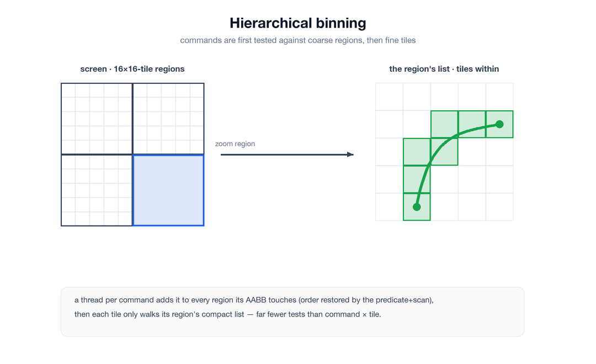
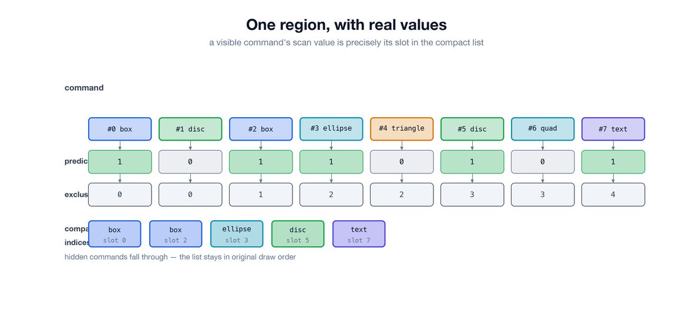
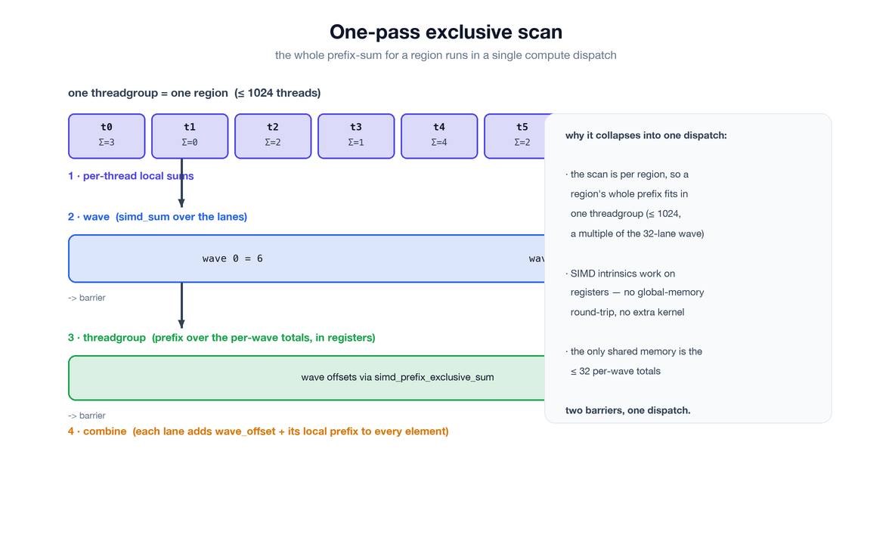

# onedraw — a GPU-driven 2D renderer

## Performance considerations

Even though binning runs on the GPU, it is not free. Let's look at the raw numbers:

* At 1440p the screen holds **160 × 90 = 14,400 tiles**
* `onedraw` supports up to **65,536 draw commands**
* In the worst case that is roughly **943 million** intersection tests

A naïve command×tile pass could easily cost more than the actual rasterization. The two ideas below — quantized AABBs and hierarchical binning — keep the real work bounded.

---

## Quantized AABB

The first optimization is to store an **AABB** (axis-aligned bounding box) per command and use it as a cheap pre-test before any heavier intersection math. The boxes are **quantized** to the tile resolution (16 px): each edge is a single byte holding a *tile* index (`0…255`), which also caps the viewport at 256 × 16 = 4096 px.

The AABBs are also kept in a **separate buffer** from the draw commands, avoiding cache thrash and giving the predicate pass a tight, coalesced read.

---

## Hierarchical binning

Even with AABB pre-tests, many commands still force each tile to do a lot of work. To reduce that, we introduce **hierarchical binning** — pre-building a list of commands for larger screen regions:

A region covers **16 × 16 tiles**, and each region keeps a list of the commands that affect it. When binning individual tiles, we only consider the commands from that region's list instead of all global commands.

The catch: if we assign one thread per *region*, the pass is slow — there are few regions but many commands, and GPUs run best with a **large number of lightweight threads**, not a few heavy ones. So we **invert the process**: each thread handles a single command and adds it to every region its AABB touches. Doing that in parallel loses the guaranteed **command ordering**, which is critical in 2D rendering. That ordering problem is what the predicate + scan solves next.

## Predicate + exclusive scan

To restore order, we use the classic pattern:

* A **predicate** kernel evaluates the visibility of each command (one thread per command) and writes a `0` / `1` mask.
* An **exclusive scan** turns that mask into a compact position for each visible command.
* A scatter pass uses the mask + indices to write the visible commands into the region lists, in order.

This keeps a **thread-per-command** model while filtering out invisible commands. The same sequence is applied for every region. With real values for one region, a visible command's scan value is exactly its slot in the compact list, and hidden commands fall through:

## One-pass exclusive scan

Building a compact, ordered list from a per-command visibility mask is a textbook **exclusive scan**. The standard solution is *cascaded* — a block-level prefix sum, a scan over the per-block totals, then adding the offsets back — which means three or four kernel launches.

`onedraw` does the whole thing in **one dispatch**, thanks to two facts:

1. **The scan is per region.** The kernel is dispatched as a `(threads_per_region, num_regions)` grid with a `(threads_per_region, 1)` threadgroup, so *each threadgroup is one region's line of threads*. With up to 65,536 commands and `num_elements_per_thread = ⌈count / 1024⌉`, a region's entire prefix fits in a single threadgroup of at most **1,024 threads** (a multiple of the 32-lane wavefront, which `simd_prefix_exclusive_sum` requires).
2. **SIMD intrinsics collapse the middle level.** Within the threadgroup, each 32-lane wave reduces with `simd_sum` / `simd_prefix_exclusive_sum`, which operate on registers — no global-memory round trip and no extra kernel.

Inside that single dispatch the kernel runs four levels:

1. **Local (per thread).** Each thread walks its block of `num_elements_per_thread` elements, writing the running exclusive sum to `scan[]` and keeping `local_sum` — the visible count in its block.
2. **Wave (32 lanes).** `simd_sum(local_sum)` hands every lane the sum of the whole wave; the first lane stores it to threadgroup memory. → **barrier**
3. **Threadgroup (≤ 32 waves).** The first `num_waves` lanes run `simd_prefix_exclusive_sum` over the per-wave totals to compute each wave's offset. → **barrier**
4. **Combine.** Every lane adds `wave_offset + simd_prefix_exclusive_sum(its local_sum)` to each element of its block.

The only shared-memory traffic is the ≤ 32 per-wave totals, so a region's entire prefix sum finishes in one compute dispatch with two barriers. The following `region_bin` kernel then scatters each visible command into its region's slot at the scanned position — using a **reversed index** so that the later tile linked-list (built by prepending) ends up front-to-back.

You can look at the [binning shader](../src/shaders/binning.metal).

---

[Next part](part3.md) : Rasterization
