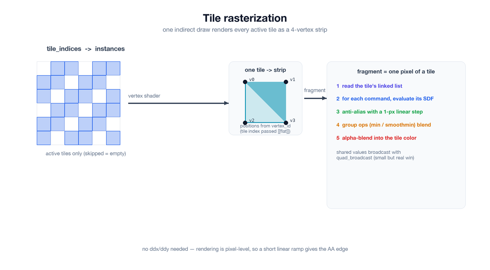
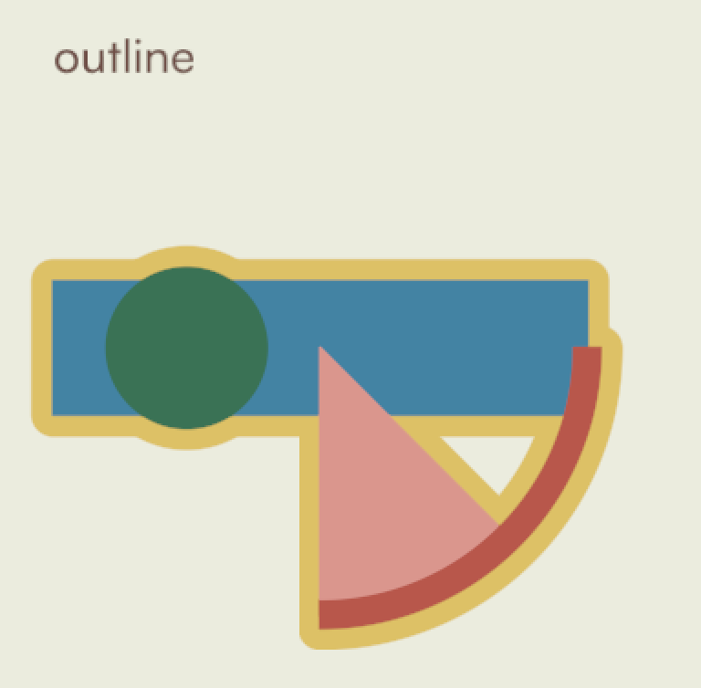
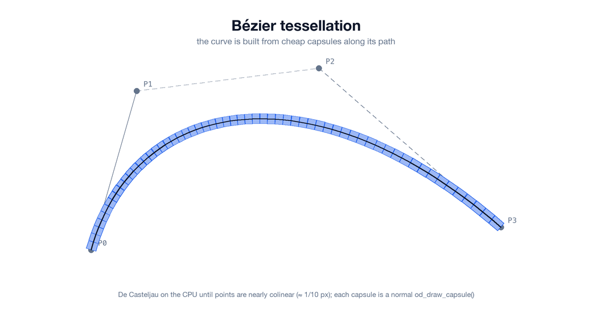
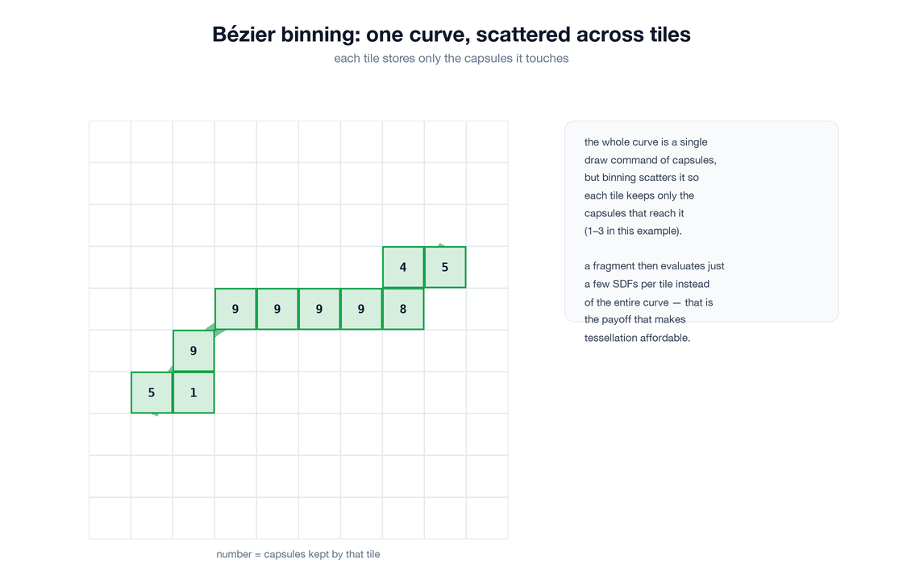

# onedraw — a GPU-driven 2D renderer

## Rasterization shaders



The compute stage produces an array of active tile indices. An **indirect draw call** uses that array to decide how many instances to render; each instance is one tile, drawn as a **triangle strip** with four vertices.

#### Vertex shader

In the vertex shader, the tile index is fetched from the array using the **instance_id**:

```C
uint16_t tile_index = tile_indices[instance_id];
uint16_t tile_x = tile_index % input.num_tile_width;
uint16_t tile_y = tile_index / input.num_tile_width;
```

The vertex positions are then generated from the **vertex_id**:

```C
float2 screen_pos = float2(vertex_id&1, vertex_id>>1);
screen_pos += float2(tile_x, tile_y);
screen_pos *= TILE_SIZE;
```

The tile index is also passed to each vertex with **no interpolation** (`[[flat]]`), so the value stays constant across the whole tile.

#### Fragment shader

In the fragment shader, the **tile index** selects the linked list of draw commands, which are processed in order. The output color starts at the clear color and standard **alpha blending** accumulates the final result. For **groups of shapes**, the selected operator (`min` or `smoothmin`) is used to fold the distances and blend the colors before the group contributes to the tile.

##### Intrinsics

A few values that are shared across the quad are propagated with `quad_broadcast` to shave a little work — visible in the profiler, but a small win.

## Signed distance functions

The SDFs are taken mainly from Inigo Quilez's [website](https://iquilezles.org/articles/distfunctions2d/). The ellipse SDF comes from [this shadertoy by quagnz](https://www.shadertoy.com/view/tt3yz7), and the gaussian-blurred box is inspired by [oneshade's shader](https://www.shadertoy.com/view/NsVSWy).

For the smooth minimum we use the [quadratic polynomial](https://iquilezles.org/articles/smin/) version, which also blends the material attribute (in our case, color).

## Anti-aliasing

Because rendering operates at the pixel level, there is no need to compute a pixel length with `ddx` / `ddy`. The alpha transition typically spans about one pixel, so a short **linear ramp** is used instead of `smoothstep`.

Outlines use the same technique to smooth both edges — the transition to the background and the transition to the shape's color.



## Bézier curves

We began with the Bézier SDF approach — there are many examples on Shadertoy, [like this one](https://www.shadertoy.com/view/MlKcDD). Two problems were never fully resolved:

* **Complex math** — especially for cubic curves. The [bounding box](https://iquilezles.org/articles/bezierbbox/) of a curve is often far too large, so we end up solving a degree-3 equation for a **lot** of pixels; culling does not help much.
* **Float precision** — in screen-space coordinates the math becomes numerically unstable at limited float precision. Mitigations exist, but none are fully robust, and they add both complexity and overhead.

##### Transition to tessellation

We eventually switched (reluctantly!) to a tessellation-based scheme, which brought one decisive advantage: if we tessellate the curve from a cheap primitive, then — with hierarchical binning — we can limit evaluation to just a few SDFs per tile per curve.





The numbers make the win concrete: the whole curve is a single draw command of capsules, but binning scatters it so each tile keeps only the capsules that reach it (1–3 here). A fragment shader then evaluates just a few SDFs per tile instead of every capsule in the curve — that is the payoff that makes tessellation affordable.


##### Tessellation details

Tessellation is done on the **CPU** with De Casteljau's algorithm until points are nearly colinear (the current threshold is 1/10th of a pixel). Splits are proportional to segment length, which performs slightly better than a fixed halfway split (`t = 0.5`) while remaining cheap. The recursion runs on a fixed-size stack (1024 deep) and returns `UINT32_MAX` if a pathological curve overflows it. We support both **quadratic** and **cubic** Bézier curves; each emitted capsule is a normal `od_draw_capsule()` call, so it flows through the same binning and rasterization path as every other primitive.

---

[Next part](part4.md) : Font and textured quads
