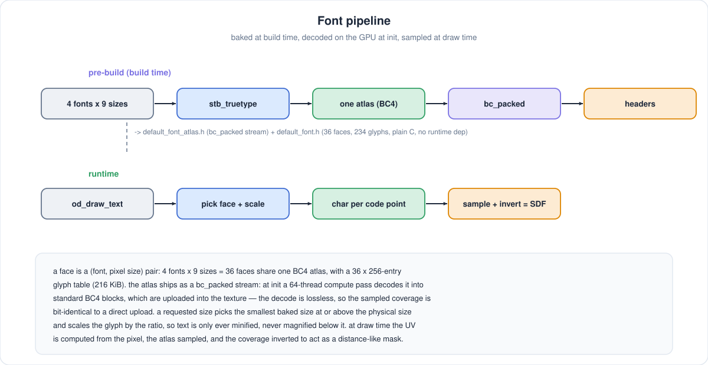
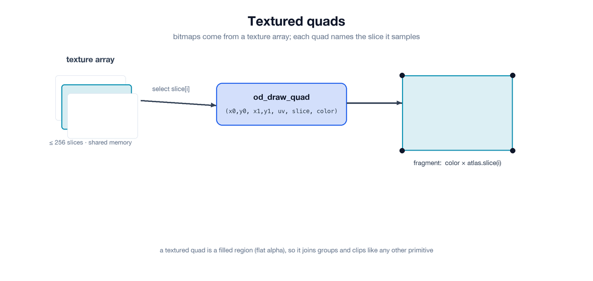

# onedraw — a GPU-driven 2D renderer

## Font

Text rendering is built on top of [stb_truetype.h](https://github.com/nothings/stb), though it could be adapted to another library.

Four font families — Satoshi **regular**, **bold**, **italic**, and **JetBrains Mono** — are baked during the **pre-build** phase, each at nine sizes (12 to 64 px), for a total of 36 faces. Every face holds the same 234 glyphs: ASCII, the Latin-1 supplement, the punctuation needed for western european languages, and a set of typography, math, arrow and shape symbols. The whole set is packed into a **single BC4 atlas** (a single-channel format — ideal for a luminance atlas, capped at 2048×2048) plus one glyph table (36 faces × 256 entries, 224 KiB). The BC4 image is then compressed with `bc_packed` (a lossless BC4 streamer from `third_party/`), and both are exported into header files (`default_font_atlas.h` and `default_font.h`), so the baked font ships as plain C and adds no runtime dependency. When `onedraw` is initialized, the packed stream is decoded on the GPU by a 64-thread compute pass (`bc_decompress`) into the standard BC4 blocks, which are uploaded into the atlas texture, and the glyph table is uploaded — both once. The decode is lossless: the texture ends up bit-identical to the baked BC4 image.

There is no font state anymore: every text call states its family (`od_font`) and its size in canvas units. The renderer converts the size to device pixels (`size × canvas scale`), picks the smallest baked size that is ≥ it, and minifies by the ratio — glyphs are only ever minified, which stays sharper than magnifying a smaller bake. A 12 px request on a 1x display uses the 12 px face at scale 1.0, a 14 px request uses the 16 px face at 0.875; above 64 px the largest face is magnified and gets progressively soft. `od_text_width()`, `od_text_ascent()` and `od_text_line_height()` resolve the same face, so mixed sizes can be measured, laid out, and aligned on their baselines in canvas units.

At runtime, each glyph is a draw command carrying its top-left position, its scale, and its face index (family × size, plus the code point). In the fragment shader, the UV is computed from the pixel position and used to sample the atlas (the alpha is inverted to act as a distance-like mask, so glyph edges are anti-aliased exactly like every other SDF).

Strings are **UTF-8**. One code point is one precomposed glyph; shaping, combining marks, bidirectional text and font fallback are explicitly out of scope. Unknown code points and invalid sequences advance by the space width and draw nothing (no-break spaces and the soft hyphen behave the same).

A different set of fonts can be baked by editing the pre-build step (`pre-build/builder.c`); a *runtime* API to let users provide their own fonts is still planned. As for SDF fonts, we are not opposed to them, but there is currently no widely accepted standard (for instance, `stb_truetype` only exports distance values, which can introduce artifacts). Simplicity is a core design goal of this project, and we want to avoid forcing users to rely on specific atlas generation tools.

## Textured quad

Bitmap rendering uses a **texture array**. When `onedraw` is initialized, the user can specify the texture array dimensions and the number of slices (up to 256). Slices — or a region of a slice, with `od_upload_region()` — can be uploaded at any time, but because textures use shared memory, updating a slice while it is being sampled by the GPU may lead to flickering or corruption — synchronization on upload is the user's responsibility.

At runtime, `od_draw_quad()` / `od_draw_oriented_quad()` pass the quad's UVs along with the slice index. In the rasterizer, the pixel is mapped through the quad (and, for oriented quads, through the rotation), the UV is interpolated, and the texture is sampled from the selected slice, then multiplied by the command color — exactly like font rendering.

We plan to let users configure texture filtering in the future; linear filtering is used by default.

> **Note** — a textured quad is a *filled* region, not an SDF: it contributes a flat alpha and is blended into the tile like any other shape, so it participates in groups and clip shapes just like the other primitives.

---

[Next part](part5.md) : Stats and next steps
