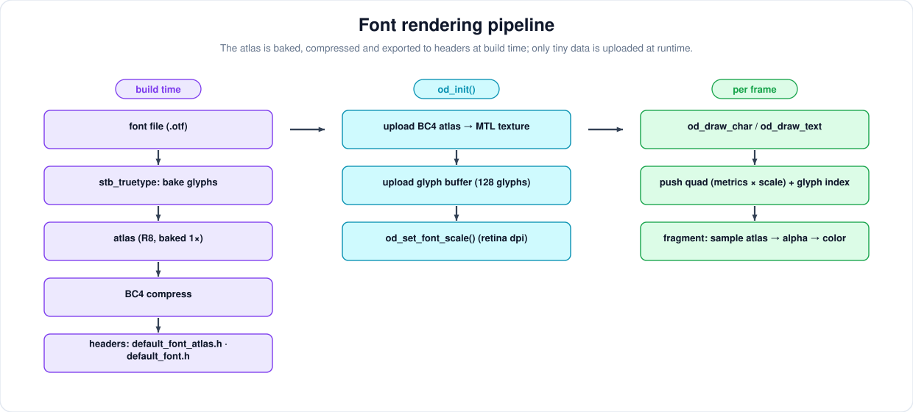
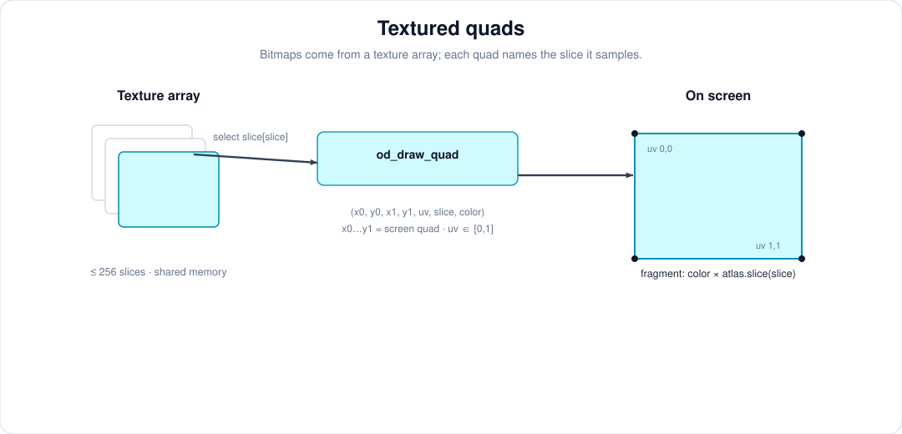

# onedraw — a GPU-driven 2D renderer

## Font

Font rendering is currently quite basic and primarily built on top of [stb_truetype.h](https://github.com/nothings/stb), though it could be adapted to another library.  
During the **pre-build** phase, the font is loaded, an atlas is generated, compressed to **BC4** (a single-channel format — ideal for a luminance atlas), and the glyph data is extracted. All of this is then exported into header files (`default_font_atlas.h` and `default_font.h`), so the baked font ships as plain C and adds no runtime dependency.

When `onedraw` is initialized, both the atlas texture and the glyph buffer are uploaded to the GPU.

At runtime, when calling `od_draw_char()`, a draw command is pushed using a quad adjusted to the glyph metrics and the character index. In the fragment shader, the UV coordinates are computed from the pixel position and used to sample the atlas texture (the alpha is inverted to act as a distance-like mask, so glyph edges are anti-aliased like every other SDF).

The atlas is baked at 1x resolution, so on a high-dpi display (e.g. a retina screen) the text would appear smaller relative to the rest of the scene. `od_set_font_scale()` applies a scale factor to the glyph size, bearings and advances, and the `od_text_height()`/`od_text_width()` measurements. Pass `sapp_dpi_scale()` (2.0 on a retina display) and update it when the window is resized, since the scale can change when the window is moved between displays.

We plan to extend the API to let users provide their own fonts. As for SDF fonts, we’re not opposed to them, but there’s currently no widely accepted standard (for instance, `stb_truetype` only exports distance values, which can introduce artifacts).  
Simplicity is a core design goal of this project, and we want to avoid forcing users to rely on specific atlas generation tools.

## Textured quad

We support bitmap rendering using a **texture array**. When `onedraw` is initialized, the user can specify the texture array dimensions and the number of slices (up to 256).  
Slices can be uploaded at any time, but since textures use shared memory, updating a slice while it’s being sampled by the GPU may lead to flickering or corruption. It’s the user’s responsibility to handle synchronization when uploading.

At runtime, when calling `od_draw_quad()` or `od_draw_oriented_quad()`, the UVs of the quad are passed along with the slice index. In the rasterizer shader, the pixel is mapped through the quad (and, for oriented quads, through the rotation), the UV is interpolated, and the texture is sampled from the selected slice — then multiplied by the command color, exactly like font rendering.

We plan to allow users to configure texture filtering in the future. Currently, linear filtering is used by default.

> **Note** — a textured quad is a *filled* region, not an SDF: it contributes a flat alpha and is blended into the tile like any other shape, so it participates in groups and clip shapes just like the other primitives.

---

[Next part](part5.md) : Stats and next steps
