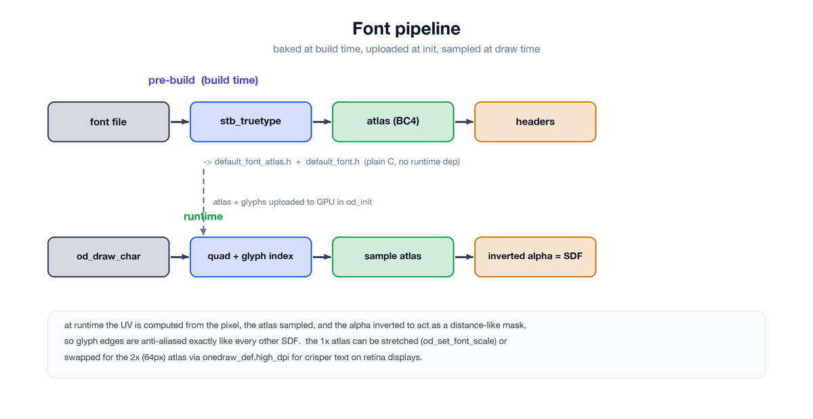
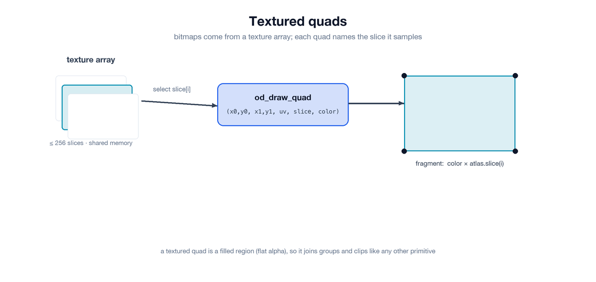

# onedraw — a GPU-driven 2D renderer

## Font

Font rendering is currently quite basic and built on top of [stb_truetype.h](https://github.com/nothings/stb), though it could be adapted to another library.

During the **pre-build** phase, the font is loaded, an atlas is generated, compressed to **BC4** (a single-channel format — ideal for a luminance atlas), and the glyph data is extracted. All of this is exported into header files (`default_font_atlas.h` and `default_font.h`), so the baked font ships as plain C and adds no runtime dependency. When `onedraw` is initialized, both the atlas texture and the glyph buffer are uploaded to the GPU.

At runtime, `od_draw_char()` pushes a draw command using a quad adjusted to the glyph metrics plus the character index. In the fragment shader, the UV is computed from the pixel position and used to sample the atlas (the alpha is inverted to act as a distance-like mask, so glyph edges are anti-aliased exactly like every other SDF).

The default atlas is baked at 1x (24 px), so on a high-dpi display (e.g. a retina screen) text would appear smaller and blurrier relative to the rest of the scene. Two approaches are available:

* `od_set_font_scale()` applies a scale factor to the glyph size, bearings, advances, and the `od_text_height()` / `od_text_width()` measurements. Pass `sapp_dpi_scale()` (2.0 on a retina display) and update it when the window is resized, since the scale can change when the window is moved between displays. The 1x atlas is stretched to that scale, so edges stay slightly soft.
* `onedraw_def.high_dpi` selects a second, 2x-resolution atlas (baked at 48 px) that is sampled at native retina size, giving crisper text. Set it in `od_init()` when targeting a high-dpi display and keep `od_set_font_scale()` at 1.0.

We plan to extend the API to let users provide their own fonts. As for SDF fonts, we are not opposed to them, but there is currently no widely accepted standard (for instance, `stb_truetype` only exports distance values, which can introduce artifacts). Simplicity is a core design goal of this project, and we want to avoid forcing users to rely on specific atlas generation tools.

## Textured quad

Bitmap rendering uses a **texture array**. When `onedraw` is initialized, the user can specify the texture array dimensions and the number of slices (up to 256). Slices can be uploaded at any time, but because textures use shared memory, updating a slice while it is being sampled by the GPU may lead to flickering or corruption — synchronization on upload is the user's responsibility.

At runtime, `od_draw_quad()` / `od_draw_oriented_quad()` pass the quad's UVs along with the slice index. In the rasterizer, the pixel is mapped through the quad (and, for oriented quads, through the rotation), the UV is interpolated, and the texture is sampled from the selected slice, then multiplied by the command color — exactly like font rendering.

We plan to let users configure texture filtering in the future; linear filtering is used by default.

> **Note** — a textured quad is a *filled* region, not an SDF: it contributes a flat alpha and is blended into the tile like any other shape, so it participates in groups and clip shapes just like the other primitives.

---

[Next part](part5.md) : Stats and next steps
