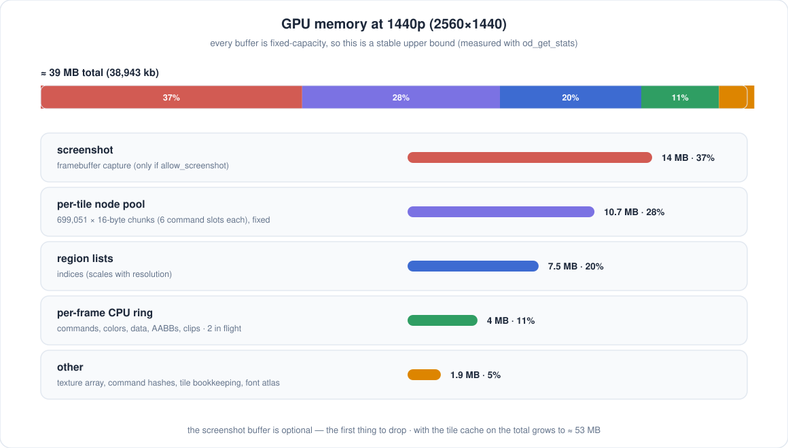

# onedraw — a GPU-driven 2D renderer

## Memory

The chart above breaks down the renderer's **GPU memory at 1440p (2560×1440)** into its pieces — **≈ 39 MB (38,943 kb)** with the cache off. Because every buffer is fixed-capacity, the figure reported by `od_get_stats()` is a stable upper bound rather than a per-frame measurement — it stays the same no matter how many commands you actually draw in a frame.

The biggest consumer is the **screenshot** buffer, and it is the only piece that does not have to be there: it is the framebuffer-sized capture texture, present only when `allow_screenshot` is set, so it is the first thing to drop (~14 MB at 1440p).

Everything else:

* **Per-tile node pool (11 MB, ~28 %)** — 720,896 fixed 16-byte `node_chunk`s, each holding 6 command slots plus the link to the next chunk.
* **Region lists (7.5 MB, ~20 %)** — the per-region `indices` lists are sized to the resolution, because a command can reach several regions. (The `predicate` and `scan` buffers of the older three-kernel design are gone — region binning is fused into a single kernel now.)
* **Per-frame CPU ring (4 MB, ~11 %)** — commands, colors, draw data, quantized AABBs and clips, **double-buffered** so two frames can be in flight (the CPU encodes a frame while the GPU runs the one before).
* **Other (1.9 MB, ~5 %)** — the font atlas (BC4), the glyph buffer, the user texture array, the small per-tile head/index buffers, and the cache bookkeeping (per-tile hash, clean-tile indices, per-command content hashes).

One piece is missing from the chart on purpose: the [tile cache](part1.md) is **opt-in**, and the chart is the `cache`-off configuration, where only a 1×1 placeholder texture is kept. With the flag on, a full-screen texture in the backbuffer format (4 bytes per pixel — ~14 MiB at 1440p, up to 64 MiB at the 4096×4096 maximum) is added on top, bringing the 1440p total from ~39 MB to ~53 MB.

So the resolution-scaled screenshot, region and cache buffers are what grow with the viewport, and the fixed node pool sets the floor.

## Performance

Measured with `od_get_stats()` on an M2 Max (30-core GPU) at 2560×1440, running the full-feature test scene (2,086 peak commands per frame) — the raw log is in [perf_log](perf_log.md):

| | no cache | cache on |
|---|---|---|
| **GPU time** | 0.63 ms (binning 0.21 ms, rasterization 0.42 ms) | 0.32 ms (binning 0.22 ms, rasterization 0.10 ms) |
| **GPU memory** | 38,943 kb (~39 MB) | 53,663 kb (~53 MB) |

The chunked per-tile lists cut ~21 MB out of the GPU memory of the previous node layout (60,783 → 38,943 kb) with no measurable change in frame time; with the tile cache on, the rasterization pass drops to about a quarter of its cost, since unchanged tiles are redrawn from the cache instead of being re-shaded.

## Next steps

Some topics we might explore:

* filtering support for textured quads
* texture format support for the texture array
* gradient fills for the remaining shapes (a radial disc and a two-color capsule are supported today)
* making the buffer capacities configurable to bring the fixed overhead down
