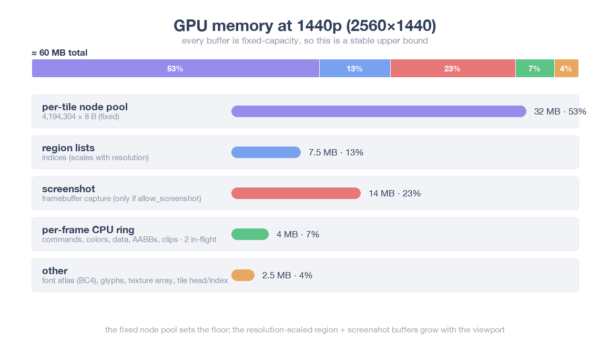

# onedraw — a GPU-driven 2D renderer

## Memory

To be honest, the memory usage is a bit higher than I would like. The chart above breaks down the renderer's **GPU memory at 1440p (2560×1440)** into its pieces. The takeaway is that **the 32 MB per-tile node pool is the anchor**: it is the single biggest consumer (~44 %) and it is fixed, sized to `MAX_NODES_COUNT` rather than the framebuffer. `MAX_NODES_COUNT` is ~4 million by default and could be reduced to save memory.

Everything else is a smaller slice:

* **Region buffers (~26 %)** — `predicate` / `scan` / `indices` are sized to the resolution, because every command is evaluated against every region.
* **Screenshot (~20 %)** — the framebuffer-sized capture texture; it only exists when `allow_screenshot` is set, so it is the first thing to drop.
* **Per-frame CPU ring (~8 %)** — commands, colors, draw data, quantized AABBs and clips, **triple-buffered** so three frames can be in flight.
* **Other (~2 %)** — the font atlas (BC4), the glyph buffer, the user texture array, the small per-tile head/index buffers, and the cache bookkeeping (per-tile hash, clean-tile index, per-command content hash).

One piece is missing from the chart on purpose: the [tile cache](part1.md) is **opt-in**, and the chart is the `cache`-off configuration, where only a 1×1 placeholder texture is kept. With the flag on, a full-screen texture in the backbuffer format (4 bytes per pixel — ~14 MiB at 1440p, up to 64 MiB at the 4096×4096 maximum) is added on top, bringing the 1440p total from ~72 MB to ~86 MB.

So the fixed node pool sets the floor, and the resolution-scaled region, screenshot and cache buffers are what grow with the viewport. Because every buffer is fixed-capacity, the figure reported by `od_get_stats()` is a stable upper bound rather than a per-frame measurement — it stays the same no matter how many commands you actually draw in a frame.

## Next steps

Some topics we might explore:

* filtering support for textured quads
* texture format support for the texture array
* gradient fills for the remaining shapes (a radial disc and a two-color capsule are supported today)
* making the buffer capacities configurable to bring the fixed overhead down
