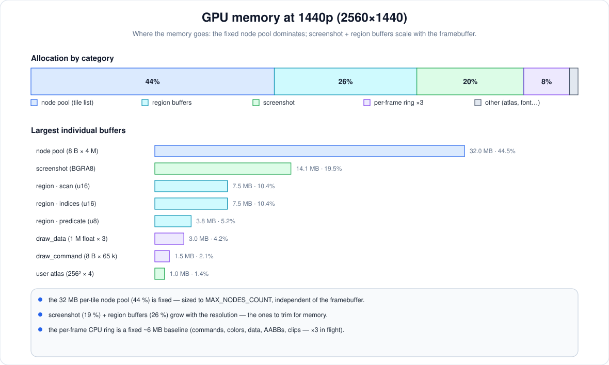

# onedraw — a GPU-driven 2D renderer

## Memory

To be honest, the memory usage is a bit higher than I’d like. The chart above breaks down the renderer’s **GPU memory at 1440p (2560×1440)** into its pieces. The takeaway is that **the 32 MB per-tile node pool is the anchor**: it’s the single biggest consumer (~44 %) and it’s fixed, sized to `MAX_NODES_COUNT` rather than the framebuffer. **MAX_NODES_COUNT** is ~4 millions by default and could be reduced to save memory.

Everything else is a smaller slice:

* **Region buffers (~26 %)** — `predicate` / `scan` / `indices` are sized to the resolution, because every command is evaluated against every region.
* **Screenshot (~20 %)** — the framebuffer-sized capture texture; it only exists when `allow_screenshot` is set, so it’s the first thing to drop.
* **Per-frame CPU ring (~8 %)** — commands, colors, draw data, quantized AABBs and clips, **triple-buffered** so three frames can be in flight.
* **Other (~2 %)** — the font atlas (BC4), the glyph buffer, the user texture array, and the small per-tile head/index buffers.

So the fixed node pool sets the floor, and the resolution-scaled region + screenshot buffers are what grow with the viewport. Because every buffer is fixed-capacity, the figure reported by `od_get_stats()` is a stable upper bound rather than a per-frame measurement — it stays the same no matter how many commands you actually draw in a frame.

## Next steps

If time permits, we'd like to work on these topics in the near future

* filtering support for textured quad
* texture format support for the texture array
* gradient (two-colors solid), radial gradient, vertical/horizontal gradient
* make the buffer capacities configurable to bring the fixed overhead down
