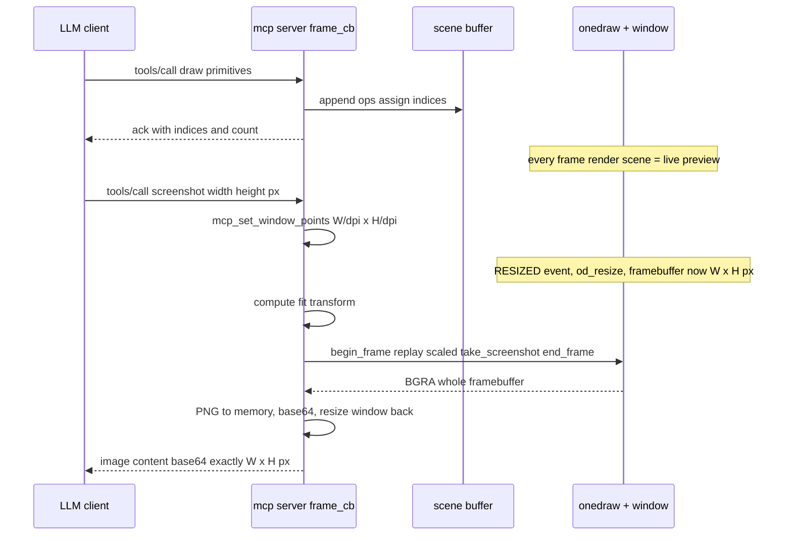

# onedraw MCP Server — Plan (v2)

A Model Context Protocol (MCP) server, `mcp`, that lets an LLM drive
[onedraw](../lib/onedraw.h) to generate images. The LLM calls one stateful tool with JSON
commands (parsed with [`sj.h`](../third_party/sj.h)); the server renders with onedraw in a visible
**live-preview window** (sokol_app) and returns screenshots as base64 PNGs over MCP **stdio**.

Decisions locked (from review): **Option B** visible window via sokol_app · stdio · **one tool** ·
**stateful** scene · **live preview** · **no CPU downscaling** — a sized screenshot resizes the framebuffer
to the exact requested pixels (÷ `dpi_scale`) · colors `#rrggbb` / `#rrggbbaa` · code lives in `tool/mcp/` ·
[`sv.h`](../third_party/sv.h) for string ops.

---

## 1. Goal & non-goals

**Goal**
- One tool, `onedraw`, the LLM calls repeatedly:
  - `clear` — restart the scene; set the logical canvas size (in **points**) and background color.
  - `draw` — append a list of primitives (all onedraw primitives incl. groups + clips); returns the assigned **indices**.
  - `update` — replace an existing primitive by its **index** (move/change any field, even the type).
  - `remove` — delete a primitive by **index** (leaves a stable hole; indices never renumber).
  - `screenshot` — render so the output is **exactly** the requested `width`×`height` **pixels** (independent of screen DPI), return a base64 PNG.
- Visible window shows a **live preview** of the current scene on every frame.
- MCP over **stdio**, **single-threaded**, using onedraw's **existing public C API only** (no lib changes).

**Non-goals (v1)**
- Textured quads (`od_draw_quad` / `od_draw_oriented_quad`) + atlas uploads — an LLM has no texture to send.
  (Atlas can still be allocated at init for a future `upload` command; quads stay out of the tool surface.)
- Non-stdio transports, animation, multi-scene.

---

## 2. Rendering model (sokol_app, visible window)

onedraw is immediate-mode ([`od_flush`](../lib/onedraw.cpp:873) clears + redraws each frame), so:

- The server keeps a **CPU-side list of draw ops** (tagged union + string pool for text), each with a
  stable integer **index** (`draw` appends, `update` replaces in place, `remove` tombstones).
- [`frame_cb`](../tests/test.c:322) runs **every vsync**: drain `stdin`, then render the whole scene — this
  is the live preview. Screenshot is just "render this frame + capture".
- We launch with `sapp_desc {1280, 720, high_dpi=true}` → **sharp** live preview; the framebuffer is
  **1280×720 × dpi_scale px** (2560×1440 on a 2× Retina screen, 1280×720 on 1×). `od_init` uses
  `sapp_width()/sapp_height()` exactly like [`test.c`](../tests/test.c:281); `SAPP_EVENTTYPE_RESIZED` →
  `od_resize` (same as [`test.c`](../tests/test.c:583)).
- Sokol has no programmatic window-resize API in this vendored copy, so we add a tiny shim
  **`tool/mcp/window.mm`** (`mcp_set_window_points(int w, int h)` → `[[NSApp mainWindow] setContentSize:...]`,
  ~15 lines, C-callable). The vendored sokol already handles the rest: its NSWindow delegate
  ([`windowDidResize:`](../third_party/sokol_app.h:6312)) calls [`_sapp_macos_update_dimensions()`](../third_party/sokol_app.h:5955),
  which recomputes `dpi_scale` from the screen, resizes the Metal framebuffer (points × dpi_scale) and emits
  `SAPP_EVENTTYPE_RESIZED`. So the shim only changes the window's **point** size; no `third_party/` changes.
  This is the mechanism behind DPI-independent screenshots (§3).
- Tile `cache = true`: the preview is mostly static between LLM edits, and the cache skips fragment work for
  unchanged tiles (see [doc/part1.md](../doc/part1.md) §75). Scale/font changes bump the frame seed, so
  screenshots still force a full redraw. (Cheap to flip off if it ever misbehaves.)

**Main thread / no locks:** sokol's macOS backend runs `[NSApp run]`; `frame_cb` executes on the main thread,
so the stdin reader (non-blocking `read()` with `O_NONBLOCK`) and the renderer share no thread — no
mutexes/atomics needed (per AGENTS.md single-thread rule).

---

## 3. Point → pixel model (exact pixel output, DPI-independent)

Two spaces:
- **Canvas** — logical rectangle in **points**, set by `clear {width, height}` (default **1024×768**).
  Primitive coordinates are always in canvas points.
- **Framebuffer** — F×G px; normally the launch size (1280×720 × dpi_scale), temporarily resized to the
  requested pixel size when taking a sized screenshot.

Every frame computes a **fit transform**: points → pixels of the current framebuffer:
```
scale = min(F / canvas_w, G / canvas_h)
offx  = (F - canvas_w*scale) * 0.5        // canvas centered in the framebuffer
offy  = (G - canvas_h*scale) * 0.5
pixel = offset + point * scale
```

- **Preview:** the whole canvas is shown centered in the framebuffer, sharp (letterbox = clear color).
- **`screenshot {width, height}`** — W×H are **output pixels, honored exactly on any screen**. The size is
  converted to *window points* by **dividing by the DPI scale**, then the framebuffer is resized until it is
  exactly W×H px:
  ```
  mcp_set_window_points(W / dpi_scale, H / dpi_scale)   // window points (sapp_dpi_scale())
  --> SAPP_EVENTTYPE_RESIZED --> od_resize(W, H)        // framebuffer is now exactly W x H px
  ```
  Once `sapp_width()/sapp_height()` report W×H (next RESIZED event → `od_resize`), that frame replays the
  scene fitted into the W×H box and captures the **whole framebuffer** → the PNG is **exactly W×H px**,
  whatever the screen DPI is (the division by `dpi_scale` cancels it). After the capture, the window is
  resized back to 1280×720 points so the preview returns to its normal size.
  - The LLM can take **multiple screenshots of the same scene at different sizes** — each is a fresh render at
    the right scale, so there is **no CPU downscaling**.
  - Constraints: W×H ≤ onedraw's 4096×4096 max, and the window must fit the screen — otherwise the response is
    an error text with the framebuffer size, so the LLM can clamp and retry.
  - **Omitted size** → no resize; capture = the canvas rect only
    (`od_set_capture_region(offx, offy, round(canvas_w*scale), round(canvas_h*scale))`) — the full-quality
    "what you see" shot.
  - Rounding: on a 2× screen even W/H are exact; odd values round to the nearest point (±1 px).
- **Font:** `high_dpi = true` (48px 2× atlas) and `od_set_font_scale(scale / 2.0)` per frame — the font tracks
  the point scale at whatever framebuffer size the frame renders at (per [doc/part4.md](../doc/part4.md:16)).
- **Colors:** `#rrggbb` (alpha 0xff) or `#rrggbbaa` → `draw_color` (A8R8G8B8, sRGB), via a small hex parser (sv.h).

---

## 4. Protocol & JSON shapes

**Transport:** MCP **stdio**, newline-delimited JSON-RPC 2.0. Requests on `stdin`, responses on
`stdout`; **all logs → `stderr`**.

**MCP messages:**
- `initialize` → `{protocolVersion, capabilities:{tools:{}}, serverInfo:{name:"onedraw-mcp",version}}`
- `notifications/initialized` → (no response)
- `tools/list` → one tool `onedraw` with an `inputSchema` describing `cmd` (enum: clear/draw/update/remove/screenshot)
  + `width`, `height`, `background`, `index`, `primitives` fields.
- `tools/call` → dispatch:
  - `clear`/`draw`/`update`/`remove` → immediate JSON-RPC response: a `text` ack (e.g. draw returns the
    assigned indices, current op count, canvas size, framebuffer size, and the current point→pixel scale).
  - `screenshot` → **deferred** response: render this frame with capture, then after `od_end_frame` reply with
    `content: [{type:"image", data:<b64 png>, mimeType:"image/png"}, {type:"text", data:"WxH px @ scale"}]`.
- `ping` → `{}` · unknown → JSON-RPC error.

**Example tool calls:**
```json
{ "cmd": "clear", "width": 960, "height": 640, "background": "#e0e0e0" }
{ "cmd": "draw", "primitives": [
    { "type": "box",  "x0": 40, "y0": 40, "x1": 400, "y1": 240, "radius": 12, "color": "#2485a6" },
    { "type": "disc", "cx": 500, "cy": 140, "radius": 80, "color": "#c65046" },
    { "type": "text", "x": 40, "y": 280, "text": "Hello onedraw", "color": "#232228" }
] }
{ "cmd": "update", "index": 2, "type": "disc", "cx": 560, "cy": 140 }
{ "cmd": "screenshot", "width": 1280, "height": 720 }   // output pixels, honored exactly
{ "cmd": "screenshot" }                                  // default: canvas rect at preview scale
```

---

## 5. Component layout (`tool/mcp/`)

```
tool/mcp/
  mcp.h        shared types: op tagged union, scene, transform, host state
  scene.c      growable op array + string pool: reset / append / update / remove (tombstone) / replay
  parse.c      sj.h parsing of the tool JSON (all cmds + per-primitive fields), hex-color + number extractors
  image.c      PNG-in-memory (stbi_write_png_to_func) + base64 encoder
  mcp.c        JSON-RPC framing over stdin/stdout, initialize/tools/list/ping, tools/call dispatch,
               deferred screenshot response
  main.c       sokol_main: sapp_desc, init_cb (od_init), frame_cb (drain stdin -> render -> capture),
               event_cb (RESIZED -> od_resize)
  window.mm    ~15-line AppKit shim: mcp_set_window_points(w, h) -> NSWindow setContentSize (points)
```

- **All C except `window.mm`** (the only window resize point; C-callable one-liner behind it). The other
  Objective-C++ is the existing [`tests/sokol_app.mm`](../tests/sokol_app.mm) shim (reused) and `onedraw.cpp`.
  C-style throughout, matching [`test.c`](../tests/test.c).
- Build: new CMake target `mcp` → `lib/onedraw.cpp` + `tool/mcp/*.c` + `tool/mcp/window.mm` +
  `tests/sokol_app.mm`, include `third_party/`, link `Metal`, `MetalKit`, `AppKit`, `Foundation`,
  `QuartzCore` (same as `test`).

---

## 6. Primitive mapping (tool `type` → onedraw call)

| type | onedraw call |
|------|--------------|
| `disc` | [`od_draw_disc`](../lib/onedraw.h:265) |
| `ring` | [`od_draw_ring`](../lib/onedraw.h:259) |
| `disc_gradient` | [`od_draw_disc_gradient`](../lib/onedraw.h:273) |
| `box` | [`od_draw_box`](../lib/onedraw.h:359) |
| `blurred_box` | [`od_draw_blurred_box`](../lib/onedraw.h:365) |
| `line` | [`od_draw_line`](../lib/onedraw.h:293) |
| `capsule` | [`od_draw_capsule`](../lib/onedraw.h:297) |
| `capsule_gradient` | [`od_draw_capsule_gradient`](../lib/onedraw.h:301) |
| `oriented_box` | [`od_draw_oriented_box`](../lib/onedraw.h:280) |
| `oriented_rect` | [`od_draw_oriented_rect`](../lib/onedraw.h:289) |
| `ellipse` | [`od_draw_ellipse`](../lib/onedraw.h:307) |
| `ellipse_ring` | [`od_draw_ellipse_ring`](../lib/onedraw.h:314) |
| `triangle` | [`od_draw_triangle`](../lib/onedraw.h:320) |
| `triangle_ring` | [`od_draw_triangle_ring`](../lib/onedraw.h:327) |
| `sector` | [`od_draw_sector`](../lib/onedraw.h:335) |
| `sector_ring` | [`od_draw_sector_ring`](../lib/onedraw.h:344) |
| `arc` | [`od_draw_arc`](../lib/onedraw.h:353) |
| `quadratic_bezier` | [`od_draw_quadratic_bezier`](../lib/onedraw.h:404) |
| `cubic_bezier` | [`od_draw_cubic_bezier`](../lib/onedraw.h:409) |
| `char` / `text` | [`od_draw_char`](../lib/onedraw.h:371) / [`od_draw_text`](../lib/onedraw.h:377) |
| `dashed_line` | [`od_draw_dashed_line`](../lib/onedraw.h:424) |
| `dashed_ring` | [`od_draw_dashed_ring`](../lib/onedraw.h:432) |
| `dashed_box` | [`od_draw_dashed_box`](../lib/onedraw.h:440) |
| `dashed_oriented_box` | [`od_draw_dashed_oriented_box`](../lib/onedraw.h:450) |
| `dashed_ellipse_ring` | [`od_draw_dashed_ellipse_ring`](../lib/onedraw.h:459) |
| `dashed_triangle_ring` | [`od_draw_dashed_triangle_ring`](../lib/onedraw.h:467) |
| `begin_group` / `end_group` | [`od_begin_group`](../lib/onedraw.h:232) / [`od_end_group`](../lib/onedraw.h:237) |
| `push_cliprect` / `push_cliprect_rounded` / `push_clipdisc` / `pop_clip` | [`od_push_cliprect`](../lib/onedraw.h:199) / [rounded](../lib/onedraw.h:207) / [disc](../lib/onedraw.h:215) / [`od_pop_clip`](../lib/onedraw.h:221) |

- Groups/clips are first-class ops (explicit begin/end, push/pop) so the scene stays a flat, ordered,
  index-addressable list. Replay validates balance (unbalanced group/clip → error text, no render).
- Dashed ops take `dash` `{length, gap, offset, round_caps}` mirroring [`od_dash_style`](../lib/onedraw.h:65).
- Angles in radians (documented in the schema description).

---

## 7. Frame flow

```
frame_cb:
  1. drain stdin (O_NONBLOCK) -> parse JSON-RPC lines:
       initialize / tools/list / ping  -> reply on stdout immediately
       tools/call clear|draw|update|remove -> mutate scene, reply with ack (indices, count, scale)
       tools/call screenshot {W, H} px (or omitted):
            omitted -> pending_capture = canvas rect at current size
            W x H   -> pending_capture = {W, H}; mcp_set_window_points(W/dpi, H/dpi)
  2. the window resize lands over the next RESIZED event(s) -> od_resize (framebuffer updates)
  3. transform = fit(canvas, framebuffer)
     od_begin_frame; od_set_clear_color; od_set_font_scale(transform.scale/2)
     replay scene (pixel = offset + pt*scale)
     if pending_capture and sapp_width()==W && sapp_height()==H:
         od_take_screenshot(buf)                      // whole framebuffer == W x H
  4. od_end_frame(drawable)                          // waitUntilCompleted; buf filled (BGRA)
  5. if captured: BGRA -> RGBA, stbi_write_png_to_func -> b64 -> JSON-RPC image response,
     then mcp_set_window_points(1280, 720)            // preview returns to its normal size
```

The screenshot buffer is `malloc`'d per capture (transient, not a hot loop — allowed for tools).

---

## 8. Decisions — locked

| # | Decision | Value |
|---|----------|-------|
| D1 | Render host | **Visible window via sokol_app** (Option B); live preview every frame |
| D2 | Transport | **stdio**, newline JSON-RPC 2.0, logs → stderr |
| D3 | Tool surface | **One** stateful tool `onedraw`, `cmd` enum |
| D4 | State model | **Stateful**: scene persists until `clear`; indices stable (`remove` = tombstone) |
| D5 | Points/pixels | Canvas in **points**; framebuffer = 1280×720 × dpi at launch; **fit transform per frame**; no CPU downscaling |
| D6 | Screenshot size | **LLM-chosen output pixels**, honored exactly: framebuffer resized to `W/dpi × H/dpi` points → W×H px |
| D7 | Preview | Live, always on (consequence of D1), sharp (`high_dpi=true`); window briefly resizes per sized screenshot |
| D8 | Default canvas | 1024×768 pt (if `clear` omits size) — *flagged, easy to change* |
| D9 | DPI handling | `high_dpi=true`; screenshot divides the requested px by `sapp_dpi_scale()` before the window resize, so the output is DPI-independent |

---

## 9. Todo list (execution order)

- [ ] **T1 — Skeleton app.** CMake target `mcp` (`onedraw.cpp` + `tool/mcp/*.c` + `tests/sokol_app.mm`,
      frameworks). `main.c`: `sapp_desc {1280,720,high_dpi=true}`, `init_cb` → `od_init` (screenshot allowed,
      high_dpi, cache), `frame_cb` → render a static demo scene (live preview works), `event_cb` →
      `RESIZED`/`od_resize`. Verify: builds, window opens, demo renders, no validation errors.
- [ ] **T2 — Window shim.** `tool/mcp/window.mm`: `mcp_set_window_points(int w, int h)` (AppKit
      `setContentSize` on the sokol NSWindow, in points). The vendored sokol's existing RESIZED pipeline
      (dpi_scale → framebuffer → `SAPP_EVENTTYPE_RESIZED`) does the rest. No `third_party/` changes.
- [ ] **T3 — Scene buffer.** [`scene.c`]: growable op array + string pool; `reset`/`append`/`update`/`remove`
      (tombstone, stable indices); `replay(transform)` emitting every primitive/group/clip with
      point→pixel transform, hex colors, font scale; unbalanced group/clip detection.
- [ ] **T4 — Tool-JSON parser.** [`parse.c`]: `sj.h` + `sv.h` parsing of all `cmd`s and per-primitive fields
      (all §6 types), number/string/bool extractors, `#rrggbb[a]` → `draw_color`; clear errors carry the
      `sj_location` line/col.
- [ ] **T5 — Screenshot pipeline.** [`image.c`]: resize state machine (request `W/dpi × H/dpi` points, wait
      until the framebuffer reports W×H, capture the whole framebuffer, resize back), canvas-rect capture for
      the no-size case, BGRA→RGBA, `stbi_write_png_to_func` (sv-backed growable buffer) + base64 encoder.
- [ ] **T6 — MCP stdio layer.** [`mcp.c`]: newline JSON-RPC loop (drained in `frame_cb`), `initialize` /
      `tools/list` (full `inputSchema`) / `ping` / `tools/call` dispatch; immediate acks; deferred screenshot
      response; logs → stderr.
- [ ] **T7 — Test.** Drive the server through a pipe: `initialize` → `tools/list` → `clear` → `draw` →
      `update` → `screenshot` (a sized shot: assert the PNG decodes to **exactly** the requested pixels; an
      oversized shot → error) → `remove`; assert JSON-RPC validity and ack indices (reuse `stb_image.h`;
      optional PSNR vs a committed reference image). Verify build + run.
- [ ] **T8 — Docs.** README section: how to register the server, the tool's JSON contract, and a worked
      LLM example (clear → draw → screenshot).

---

## 10. Flow



## 11. Scene state machine

```
stateDiagram-v2
    [*] -> Ready
    Ready -> Ready : clear reset scene new canvas
    Ready -> Ready : draw append ops
    Ready -> Ready : update replace by index
    Ready -> Ready : remove tombstone by index
    Ready -> Rendering : screenshot this frame
    Rendering -> Ready : image response sent
```
